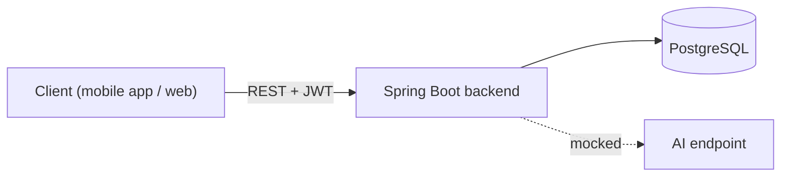
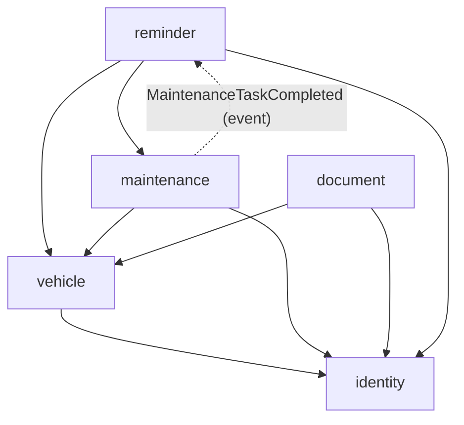

# AutoWizard

A backend for vehicle owners: keep track of your vehicles, plan their maintenance, get reminded when something is due, and store the documents that come with a car (insurance, road tax, registration, workshop invoices) in one place.

The distinctive part is where it is going: the documents users upload are meant to be **read by AI**, so that an insurance PDF or a photo of an invoice turns into expiry dates, mileage, costs and completed maintenance without typing them in.

> **Status:** the REST API for users, vehicles, maintenance tasks, reminders and documents works on PostgreSQL with Flyway migrations (Java 21, Spring Boot 4), with JWT authentication, ownership checks on every resource, validated input, RFC 7807 errors and a request id in every log line. A nightly job marks overdue tasks and keeps one reminder per user and type, emailed when it changes. The code is a modular monolith whose module boundaries are verified by a test. The AI endpoint returns a fixed mocked answer: document analysis is **planned** (a separate Python worker connected through Kafka). See [Planned next, and why](#planned-next-and-why).

---

## Contents

- [What it does](#what-it-does)
- [Design decisions worth reading](#design-decisions-worth-reading)
- [Architecture](#architecture)
- [Why this architecture](#why-this-architecture)
- [Tech stack](#tech-stack)
- [Running locally](#running-locally)
- [API overview](#api-overview)
- [Testing](#testing)
- [Configuration](#configuration)
- [Planned next, and why](#planned-next-and-why)
- [License](#license)

---

## What it does

- **Accounts.** Registration and login with email and password; every other endpoint needs the returned JWT.
- **Vehicles.** Each user manages their own vehicles (type, brand, model, plate, VIN, mileage, registration year, fuel) and updates the mileage, which can only grow. Deleting a vehicle hides it but keeps its history.
- **Maintenance tasks.** Tasks per vehicle with a scheduled date and mileage, priority and estimated cost, listed by vehicle or by user and by status (pending, overdue, completed). Completing a task records the actual cost and mileage and moves the vehicle's odometer forward.
- **Overdue detection.** Every night, tasks past their date or mileage become overdue.
- **Reminders.** One open reminder per user for overdue tasks and one for tasks due in the next 7 days, kept up to date by the nightly job and by task completions, and emailed when they change.
- **Documents.** Upload, list, download and delete PDF, JPEG or PNG files attached to a vehicle, typed as registration, insurance, road tax, maintenance invoice or past maintenance booklet.
- **AI (mocked).** `POST /api/ai/query` answers with a fixed string: a placeholder for the document analysis described in [Planned next](#planned-next-and-why).

## Design decisions worth reading

| Problem | Decision | Where |
|---|---|---|
| With HMAC, whoever knows the JWT secret can sign a token for any user, and a secret had been committed to the repository | No default secret: the application refuses to start when it is missing, shorter than 32 bytes, or equal to the exposed one. The exposed secret is recognized by its SHA-256, so the check does not publish it again. A `dev` profile holds a local-only secret | `JwtService` |
| The JWT filter verified the token more than once, turned errors into plain-text 500s and logged the `Authorization` header | The token is verified once per request; a missing or invalid token continues unauthenticated, and protected endpoints answer 401 from the entry point; tokens are never logged | `JwtAuthenticationFilter`, `SecurityConfig` |
| Credentials in configuration files end up in the repository | Secrets (JWT, mail) are read from environment variables only | `application.properties` |
| Some task listings by vehicle never checked who owns the vehicle | One place checks ownership, by loading the vehicle by id **and** owner; every vehicle-scoped operation goes through it. Someone else's vehicle, document or reminder is 404, exactly like a missing one, so ids cannot be probed | `VehicleAccess` |
| Wrong passwords and duplicate emails were 500s with messages that revealed which emails exist; "not found" and "not yours" were 400s | Exceptions by meaning (`NotFoundException` 404, `ConflictException` 409, `BusinessRuleException` 400) and RFC 7807 problem details; login through the `AuthenticationManager` with one generic 401; a 500 never carries the exception message | `GlobalExceptionHandler`, `AuthService` |
| An empty email and password created an account; a vehicle without its fields became a database error | Request records with Bean Validation, separate from response records, so clients cannot set ids, status or owner; 400 with one message per field, always in English | `*Request` records |
| A vehicle with tasks referenced by reminders could not be deleted, and deleting in cascade would lose its history | Soft delete (`deleted_at`) with `@SQLRestriction`: the vehicle disappears from every query, its tasks, documents and reminders still point to an existing row | `Vehicle` |
| The H2 console and permissive CORS were on in every environment | Both only where configured: the console in the `dev` profile (gone with H2), CORS origins from `CORS_ALLOWED_ORIGINS` (none by default) | `SecurityConfig` |
| Every handled error was logged at ERROR and the lines of one request could not be found together | `[EVENT] key=value` lines, 4xx at INFO, failed logins at WARN, 5xx at ERROR once; a request id (`X-Request-Id`, validated against log injection) in every line, in the response and in error bodies | `RequestIdFilter`, services |
| Generated `equals`/`hashCode` walked vehicle → owner → collections: generating reminders crashed as soon as a user had a task | Entities equal by id (proxy-safe, constant hash code), `toString` without associations, one security representation of a user | entities, `EntityEqualityTests` |
| Listing documents loaded every file into memory (`@Basic(fetch = LAZY)` is ignored without bytecode enhancement) | The list is a projection of the metadata; the download selects only the content; the stored type is detected from the file signature (PDF, JPEG, PNG), never taken from the client | `DocumentRepository`, `DocumentFiles` |
| Every request loaded the user, and eager associations loaded owners and vehicles again | The user id travels in the signed token; every association is lazy and fetched explicitly; no open session in view. A listing is one query, proved by capturing the SQL | `JwtAuthenticationFilter`, `QueryCountTests` |
| Costs as `Double`; `now()` called everywhere | `BigDecimal(10,2)`; one injected `TimeService`, replaced by a fixed clock in tests | `MaintenanceTask`, `TimeService` |
| Nothing ever marked a task as overdue | A nightly job with **one** `UPDATE` for all users (date passed or mileage reached, active vehicles only) | `MaintenanceTaskRepository.markOverdue` |
| Generating reminders twice created two reminders | Reminders come from the job: one open reminder per user and type, updated when its tasks change, never repeated for the same tasks; emails only for created or changed reminders, sent after the commit | `ReminderService`, `ReminderMailer` |
| Code organized by technical layer, with nothing preventing any class from using any other | Package by feature with an API package and an `internal` package per module, verified by Spring Modulith; modules react to each other through in-process events stored in the event publication registry (`MaintenanceTaskCompleted` → reminders) | `ModularityTests`, `CompletedTaskReminders` |
| Two completions in quick succession updated the same reminder from two listeners at once | The listener reads the user's open reminders with a pessimistic lock (`SELECT ... FOR UPDATE`) | `ReminderRepository` |
| The schema was generated by Hibernate on an in-memory database | PostgreSQL; the schema is Flyway migrations with named constraints and indexes, and Hibernate only **validates** it at startup | `db/migration` |
| Unique plates and one open reminder per user were check-then-insert in the services | PostgreSQL partial unique indexes (`WHERE deleted_at IS NULL`, `WHERE notified = FALSE`): two concurrent requests give one success and one 409 | `V2__…sql`, `DatabaseConstraintTests` |
| With several instances, every instance would run the nightly job | ShedLock on the database clock: one execution per night across instances | `SchedulingConfig`, `NightlyMaintenanceJob` |
| Tests on H2 proved behavior on a database that does not run in production | Every Spring test runs on PostgreSQL 16 in Docker (Testcontainers, `@ServiceConnection`) | `TestcontainersConfiguration` |

## Architecture



One Spring Boot application, organized as modules. Each module exposes a small API in its root package and keeps everything else in `internal`; arrows are allowed dependencies, checked by `ModularityTests`:



Every module also uses `shared` (exceptions by meaning, `TimeService`, the request id). `ai` holds the mocked endpoint. Documents are stored in a `bytea` column for now.

## Why this architecture

**The Java backend is a monolith on purpose.** One small team, one domain (a user, their vehicles and everything attached to them), and operations that must be consistent: completing a maintenance task updates the vehicle mileage in the same transaction, and the reminders react to it through an in-process event. Splitting this into services would add network calls and distributed failure modes without solving any problem the application has.

**The AI part will be a separate service, connected through a message broker.** Reading a document is a different kind of work: it takes seconds, not milliseconds; it is best done in Python, where the PDF, OCR and LLM tooling lives; and it must not lose an upload when the worker is down or being redeployed. A broker (Kafka) between the backend and a Python worker gives exactly that: the upload returns immediately, the analysis happens in the background and is retried, and the two runtimes share only the event schema. This is planned, not built yet.

## Tech stack

| Layer | Technology |
|---|---|
| Language and framework | Java 21, Spring Boot 4.0 |
| Persistence | PostgreSQL 16, Spring Data JPA (Hibernate 7), Flyway |
| Modules | Spring Modulith 2.0 (boundary verification, event publication registry) |
| Security | Spring Security 7, JWT (jjwt 0.13), BCrypt |
| Jobs | Spring scheduling with ShedLock |
| Build and local infrastructure | Maven (wrapper included), Docker Compose |
| Tests | JUnit 5, Spring Boot Test, MockMvc, Testcontainers, Awaitility |
| Planned | Object storage (S3 / MinIO), Kafka, Python AI worker |

## Running locally

**Prerequisites:** JDK 21 and Docker.

```bash
docker compose up -d                                   # PostgreSQL on localhost:5432
./mvnw spring-boot:run -Dspring-boot.run.profiles=dev
```

If port 5432 is taken (e.g. by a local PostgreSQL), set `POSTGRES_PORT=55432` for both commands. Without Compose, `./mvnw spring-boot:test-run -Dspring-boot.run.profiles=dev` starts the application with a throw-away PostgreSQL container.

The `dev` profile provides a local JWT secret and the local database credentials. Without it the application refuses to start until `JWT_SECRET` and the datasource are set (see [Configuration](#configuration)).

A quick tour with curl:

```bash
# Register and keep the token
TOKEN=$(curl -s localhost:8080/api/auth/register -H 'Content-Type: application/json' \
  -d '{"email":"mario@example.com","password":"password-123","firstName":"Mario","lastName":"Rossi"}' \
  | sed 's/.*"token":"\([^"]*\)".*/\1/')

# Add a vehicle
curl -s localhost:8080/api/vehicles -H "Authorization: Bearer $TOKEN" -H 'Content-Type: application/json' \
  -d '{"type":"CAR","brand":"Fiat","model":"Panda","licensePlate":"AB123CD","vin":"ZFA31200000123456","mileage":42000,"registrationYear":2019,"fuel":"BENZINA"}'

# Upload a document for vehicle 1
curl -s localhost:8080/api/documents/upload -H "Authorization: Bearer $TOKEN" \
  -F file=@insurance.pdf -F type=ASSICURAZIONE -F vehicleId=1
```

`AutoWizard.postman_collection.json` contains the same requests for Postman.

## API overview

All endpoints except `/api/auth/**` require `Authorization: Bearer <token>`.

| Method | Path | Description |
|---|---|---|
| POST | `/api/auth/register` | Create an account, returns a token |
| POST | `/api/auth/login` | Log in, returns a token |
| GET / POST | `/api/vehicles` | List / create the caller's vehicles |
| GET / DELETE | `/api/vehicles/{id}` | Read / delete one vehicle |
| PATCH | `/api/vehicles/{id}/mileage?newMileage=` | Update the mileage (never lower) |
| POST | `/api/maintenance-tasks` | Create a task for one of the caller's vehicles |
| GET | `/api/maintenance-tasks/vehicle/{vehicleId}` | Tasks of a vehicle |
| GET | `/api/maintenance-tasks/{pending,overdue,completed}/user` | The caller's tasks by status |
| GET | `/api/maintenance-tasks/{pending,overdue,completed}/vehicle/{vehicleId}` | A vehicle's tasks by status |
| GET | `/api/maintenance-tasks/user` | All the caller's tasks |
| PATCH | `/api/maintenance-tasks/{id}/complete` | Complete a task: `completionMileage`, optional `actualCost` and `completionDate` |
| GET | `/api/reminders` | The caller's open reminders (created by the nightly job) |
| PUT | `/api/reminders/{id}/notified` | Mark a reminder as notified |
| POST | `/api/documents/upload` | Upload a file (`file`, `type`, `vehicleId`) |
| GET | `/api/documents/vehicle/{vehicleId}` | List a vehicle's documents |
| GET / DELETE | `/api/documents/{id}` | Download / delete a document |
| POST | `/api/ai/query` | Mocked AI answer |

**Errors** are [RFC 7807](https://www.rfc-editor.org/rfc/rfc7807) problem details (`application/problem+json`) with `type`, `title`, `status`, `detail`, `requestId` and, for validation errors, an `errors` map of field to message:

| Status | When |
|---|---|
| 400 | Invalid input, unreadable body, wrong parameter type, broken business rule (e.g. a lower mileage) |
| 401 | Missing or invalid token; failed login (same message for unknown email and wrong password) |
| 404 | Unknown route, or a resource that does not exist **or belongs to another user** |
| 409 | Email, plate or VIN already registered; task already completed |
| 415 | Uploaded file is not a PDF, JPEG or PNG |
| 500 | Unexpected failure; the body never contains the exception message, the log has the stack trace and the same request id |

## Testing

```bash
./mvnw clean verify      # needs Docker: the tests run on PostgreSQL containers
```

| Test class | What it proves |
|---|---|
| `JwtServiceTests` | Missing, short and exposed secrets stop the startup; issued tokens verify, tampered, expired and foreign-key tokens do not |
| `JwtSecurityTests` | Missing, garbage and forged tokens get 401; an invalid token does not block public endpoints; tokens never appear in the logs, even at DEBUG |
| `OwnershipTests` | Another user gets 404 on every vehicle-scoped endpoint, exactly like for a missing vehicle; the owner can read everything |
| `ErrorModelTests` | 400, 401, 404 and 409 cases with problem details; unknown email and wrong password are indistinguishable; someone else's document looks missing |
| `ServerErrorTests` | An unexpected exception is a 500 without its message |
| `ValidationTests` | Empty registration, incomplete vehicle, unknown fuel and negative mileage are 400 with field errors, in English; a client cannot set the status of a new task |
| `VehicleDeletionTests` | A vehicle with tasks referenced by reminders and documents can be deleted, disappears from the API and leaves no dangling reference; its plate can be registered again |
| `CorsTests`, `ProductionDefaultsTests` | CORS only from configured origins; without the `dev` profile no cross-origin access and frames denied |
| `LoggingTests`, `RequestIdTests` | One `[EVENT]` line per event at the right level, no passwords or file names; the request id in header, error body and logs, unsafe incoming ids replaced |
| `EntityEqualityTests` | Reminders can be generated for tasks in a set; an entity equals a proxy of itself; `toString` does not touch associations |
| `DocumentTests` | Listing documents never selects their content; the stored type comes from the file, not the client; only PDF, JPEG and PNG; safe, encoded file names |
| `QueryCountTests` | Listing vehicles or tasks is one SQL statement, whatever the number of rows |
| `MoneyAndTimeTests` | Costs are exact decimals with at most two digits; timestamps come from the injected clock |
| `MaintenanceRulesTests` | Completion rules and mileage rules, without Spring |
| `TaskCompletionTests` | Completing a task updates the vehicle mileage; a task cannot be completed twice; ownership and validation |
| `NightlyJobTests` | With a fixed clock: overdue by date or mileage, completed and deleted left alone; two runs create one reminder, which follows the tasks and is emailed once per change; a failing mail server loses nothing |
| `TaskEventsTests` | A completed task leaves the open reminders through `MaintenanceTaskCompleted`; concurrent listeners on one reminder leave it consistent |
| `ModularityTests` | No module uses another module's internals, no cycles; writes the module diagrams |
| `DatabaseConstraintTests` | Concurrent registrations of one plate give one 200 and one 409; plates unique among active vehicles only; one open reminder per user and type |
| `SchedulerLockTests` | A second trigger of the nightly job inside the lock window does nothing |
| `AutoWizardApplicationTests` | The application context starts with the `dev` profile |

## Configuration

| Variable | Required | Description |
|---|---|---|
| `JWT_SECRET` | yes (outside `dev`) | HMAC key for the tokens, at least 32 bytes. Generate one with `openssl rand -base64 48` |
| `SPRING_DATASOURCE_URL`, `SPRING_DATASOURCE_USERNAME`, `SPRING_DATASOURCE_PASSWORD` | yes (outside `dev`) | PostgreSQL connection; the schema is created by the migrations |
| `POSTGRES_PORT` | no | Host port of the Compose database and of the `dev` datasource, default `5432` |
| `MAIL_HOST`, `MAIL_PORT` | no | SMTP server, default `smtp.gmail.com:587` |
| `MAIL_USERNAME`, `MAIL_PASSWORD` | no | SMTP credentials |
| `MAIL_ENABLED` | no | `true` to email reminders (default `false`) |
| `MAIL_FROM` | no | Sender of the reminder emails, default `MAIL_USERNAME` |
| `CORS_ALLOWED_ORIGINS` | no | Comma-separated browser origins allowed to call the API. Empty (default) = none |
| `APP_TIME_ZONE` | no | Zone of the users, for local dates and the nightly job, default `Europe/Rome` |

## Planned next, and why

| Step | Problem it solves |
|---|---|
| Documents in object storage | Files in the database grow backups and fill the heap on reads |
| AI document analysis through Kafka and a Python worker | Users type by hand what is already written in their documents |

## License

MIT, see [LICENSE](LICENSE).
