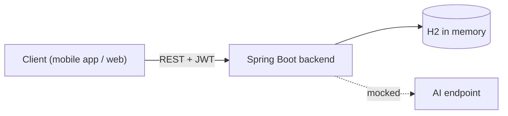

# AutoWizard

A backend for vehicle owners: keep track of your vehicles, plan their maintenance, get reminded when something is due, and store the documents that come with a car (insurance, road tax, registration, workshop invoices) in one place.

The distinctive part is where it is going: the documents users upload are meant to be **read by AI**, so that an insurance PDF or a photo of an invoice turns into expiry dates, mileage, costs and completed maintenance without typing them in.

> **Status:** the REST API for users, vehicles, maintenance tasks, reminders and documents works on an in-memory H2 database, with JWT authentication. The AI endpoint returns a fixed mocked answer: document analysis is **planned** (a separate Python worker connected through Kafka). Known correctness and security problems are being fixed one by one: see [Planned next, and why](#planned-next-and-why).

---

## Contents

- [What it does](#what-it-does)
- [Design decisions worth reading](#design-decisions-worth-reading)
- [Architecture](#architecture)
- [Why this architecture](#why-this-architecture)
- [Tech stack](#tech-stack)
- [Running locally](#running-locally)
- [API overview](#api-overview)
- [Testing](#testing)
- [Configuration](#configuration)
- [Planned next, and why](#planned-next-and-why)
- [License](#license)

---

## What it does

- **Accounts.** Registration and login with email and password; every other endpoint needs the returned JWT.
- **Vehicles.** Each user manages their own vehicles (type, brand, model, plate, VIN, mileage, registration year, fuel) and updates the mileage, which can only grow.
- **Maintenance tasks.** Tasks per vehicle with a scheduled date and mileage, priority and estimated cost, listed by vehicle or by user and by status (pending, overdue, completed).
- **Reminders.** Reminders that group a user's pending or overdue tasks.
- **Documents.** Upload, list, download and delete files attached to a vehicle, typed as registration, insurance, road tax, maintenance invoice or past maintenance booklet.
- **AI (mocked).** `POST /api/ai/query` answers with a fixed string: a placeholder for the document analysis described in [Planned next](#planned-next-and-why).

## Design decisions worth reading

| Problem | Decision | Where |
|---|---|---|
| With HMAC, whoever knows the JWT secret can sign a token for any user, and a secret had been committed to the repository | No default secret: the application refuses to start when it is missing, shorter than 32 bytes, or equal to the exposed one. The exposed secret is recognized by its SHA-256, so the check does not publish it again. A `dev` profile holds a local-only secret | `JwtService` |
| The JWT filter verified the token more than once, turned errors into plain-text 500s and logged the `Authorization` header | The token is verified once per request; a missing or invalid token continues unauthenticated, and protected endpoints answer 401 from the entry point; tokens are never logged | `JwtAuthenticationFilter`, `SecurityConfig` |
| Credentials in configuration files end up in the repository | Secrets (JWT, mail) are read from environment variables only | `application.properties` |

## Architecture



One Spring Boot application with controllers, services and Spring Data JPA repositories. Documents are stored as binary columns in the database.

## Why this architecture

**The Java backend is a monolith on purpose.** One small team, one domain (a user, their vehicles and everything attached to them), and operations that must be consistent: completing a maintenance task updates the vehicle mileage and the user's reminders in the same transaction. Splitting this into services would add network calls and distributed failure modes without solving any problem the application has.

**The AI part will be a separate service, connected through a message broker.** Reading a document is a different kind of work: it takes seconds, not milliseconds; it is best done in Python, where the PDF, OCR and LLM tooling lives; and it must not lose an upload when the worker is down or being redeployed. A broker (Kafka) between the backend and a Python worker gives exactly that: the upload returns immediately, the analysis happens in the background and is retried, and the two runtimes share only the event schema. This is planned, not built yet.

## Tech stack

| Layer | Technology |
|---|---|
| Language and framework | Java 17, Spring Boot 3.2 |
| Persistence | Spring Data JPA (Hibernate), H2 in memory |
| Security | Spring Security, JWT (jjwt 0.11), BCrypt |
| Build | Maven (wrapper included) |
| Tests | JUnit 5, Spring Boot Test, MockMvc |
| Planned | PostgreSQL with Flyway, object storage (S3 / MinIO), Kafka, Python AI worker |

## Running locally

**Prerequisites:** JDK 17 or newer.

```bash
./mvnw spring-boot:run -Dspring-boot.run.profiles=dev
```

The `dev` profile provides a local JWT secret. Without it the application refuses to start until `JWT_SECRET` is set (see [Configuration](#configuration)).

A quick tour with curl:

```bash
# Register and keep the token
TOKEN=$(curl -s localhost:8080/api/auth/register -H 'Content-Type: application/json' \
  -d '{"email":"mario@example.com","password":"password-123","firstName":"Mario","lastName":"Rossi"}' \
  | sed 's/.*"token":"\([^"]*\)".*/\1/')

# Add a vehicle
curl -s localhost:8080/api/vehicles -H "Authorization: Bearer $TOKEN" -H 'Content-Type: application/json' \
  -d '{"type":"CAR","brand":"Fiat","model":"Panda","licensePlate":"AB123CD","vin":"ZFA31200000123456","mileage":42000,"registrationYear":2019,"fuel":"BENZINA"}'

# Upload a document for vehicle 1
curl -s localhost:8080/api/documents/upload -H "Authorization: Bearer $TOKEN" \
  -F file=@insurance.pdf -F type=ASSICURAZIONE -F vehicleId=1
```

`AutoWizard.postman_collection.json` contains the same requests for Postman.

## API overview

All endpoints except `/api/auth/**` require `Authorization: Bearer <token>`.

| Method | Path | Description |
|---|---|---|
| POST | `/api/auth/register` | Create an account, returns a token |
| POST | `/api/auth/login` | Log in, returns a token |
| GET / POST | `/api/vehicles` | List / create the caller's vehicles |
| GET / DELETE | `/api/vehicles/{id}` | Read / delete one vehicle |
| PATCH | `/api/vehicles/{id}/mileage?newMileage=` | Update the mileage (never lower) |
| POST | `/api/maintenance-tasks` | Create a task for one of the caller's vehicles |
| GET | `/api/maintenance-tasks/vehicle/{vehicleId}` | Tasks of a vehicle |
| GET | `/api/maintenance-tasks/{pending,overdue,completed}/user` | The caller's tasks by status |
| GET | `/api/maintenance-tasks/{pending,overdue,completed}/vehicle/{vehicleId}` | A vehicle's tasks by status |
| GET | `/api/maintenance-tasks/user` | All the caller's tasks |
| PUT | `/api/reminders/{id}/notify` | Mark a reminder as notified |
| POST | `/api/reminders/generate/{pending,overdue}` | Build reminders from pending / overdue tasks |
| POST | `/api/documents/upload` | Upload a file (`file`, `type`, `vehicleId`) |
| GET | `/api/documents/vehicle/{vehicleId}` | List a vehicle's documents |
| GET / DELETE | `/api/documents/{id}` | Download / delete a document |
| POST | `/api/ai/query` | Mocked AI answer |

## Testing

```bash
./mvnw clean verify
```

| Test class | What it proves |
|---|---|
| `JwtServiceTests` | Missing, short and exposed secrets stop the startup; issued tokens verify, tampered, expired and foreign-key tokens do not |
| `JwtSecurityTests` | Missing, garbage and forged tokens get 401; an invalid token does not block public endpoints; tokens never appear in the logs, even at DEBUG |
| `AutoWizardApplicationTests` | The application context starts with the `dev` profile |

## Configuration

| Variable | Required | Description |
|---|---|---|
| `JWT_SECRET` | yes (outside `dev`) | HMAC key for the tokens, at least 32 bytes. Generate one with `openssl rand -base64 48` |
| `MAIL_HOST`, `MAIL_PORT` | no | SMTP server, default `smtp.gmail.com:587` |
| `MAIL_USERNAME`, `MAIL_PASSWORD` | no | SMTP credentials |

## Planned next, and why

| Step | Problem it solves |
|---|---|
| Ownership checks on every vehicle-scoped endpoint | Some task listings by vehicle do not check who owns the vehicle |
| An error model with the right status codes | Wrong passwords and duplicate emails are 500s; "not found" and "not yours" are 400s whose messages reveal whether a resource exists |
| Input validation | An empty email and password create an account; missing vehicle fields surface as database errors |
| A defined way to delete a vehicle | A vehicle with tasks referenced by reminders cannot be deleted |
| Development conveniences only in development | The H2 console and permissive CORS are enabled everywhere |
| Consistent logs with a request id | Every handled error is logged as an error, and log lines of one request cannot be found together |
| Entities with safe equality and explicit fetching | Generated `equals`/`hashCode` walk the object graph; every request loads the user, listings load related rows and file contents |
| Overdue detection and idempotent reminders | Nothing marks a task as overdue; generating reminders twice creates duplicates |
| PostgreSQL, schema migrations, Docker Compose | The database is in memory and the schema is generated by Hibernate |
| Documents in object storage | Files in the database grow backups and fill the heap on reads |
| AI document analysis through Kafka and a Python worker | Users type by hand what is already written in their documents |

## License

MIT, see [LICENSE](LICENSE).
